# UI review screenshots (key set)

Sample data only. These 11 pictures are the main screens. **The full set (about 320 pictures: every screen at phone, tablet and desktop, dark and light, and the text sizes) is attached to each GitHub pre-release as `ERP2-ui-review-screenshots-<date>-<commit>.zip`** to keep the repository small. You can regenerate everything yourself:

```
UI_REVIEW=1 flutter test test/ui_review/generate_test.dart
```

(the full list is then written to `docs/ui-review/index-full.md`, which git ignores).

| Screen | Picture |
|---|---|
| Home (desktop, dark) | 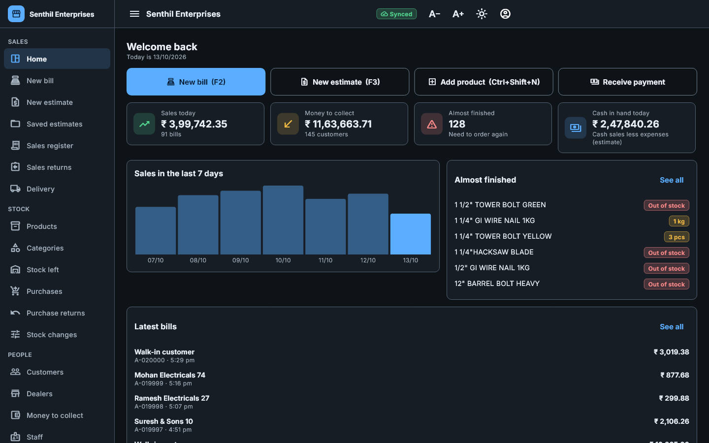 |
| New bill | 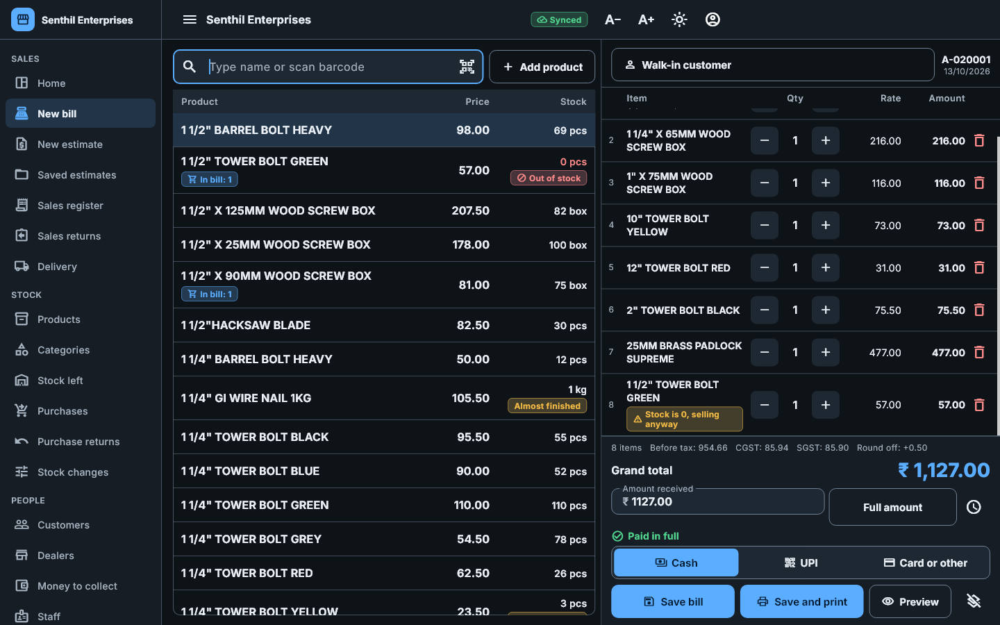 |
| Part payment: balance goes to credit | 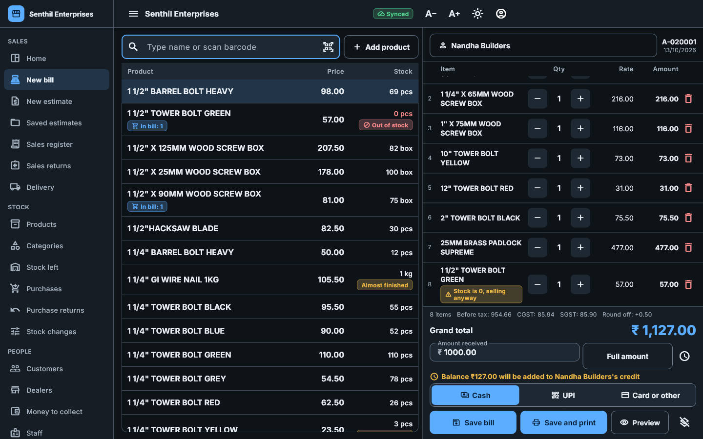 |
| Money to collect | 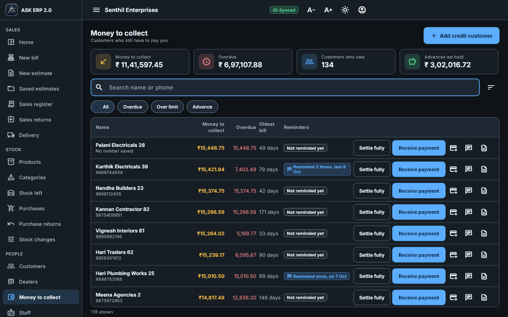 |
| Customer page (ageing, ledger, reminders) | 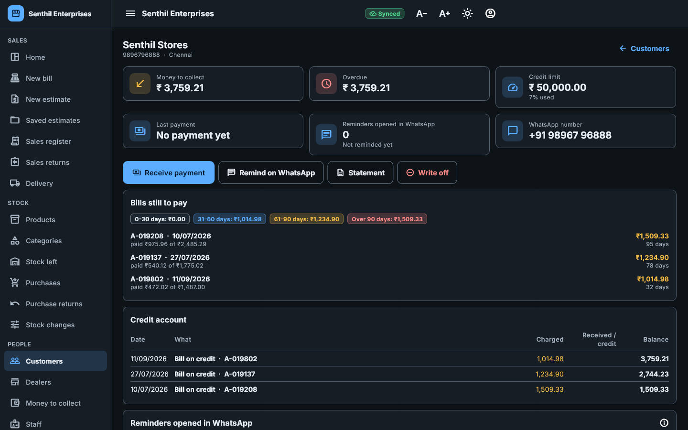 |
| WhatsApp reminder preview | 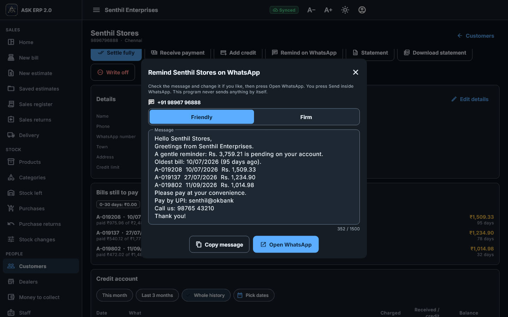 |
| Settings > Reminders | 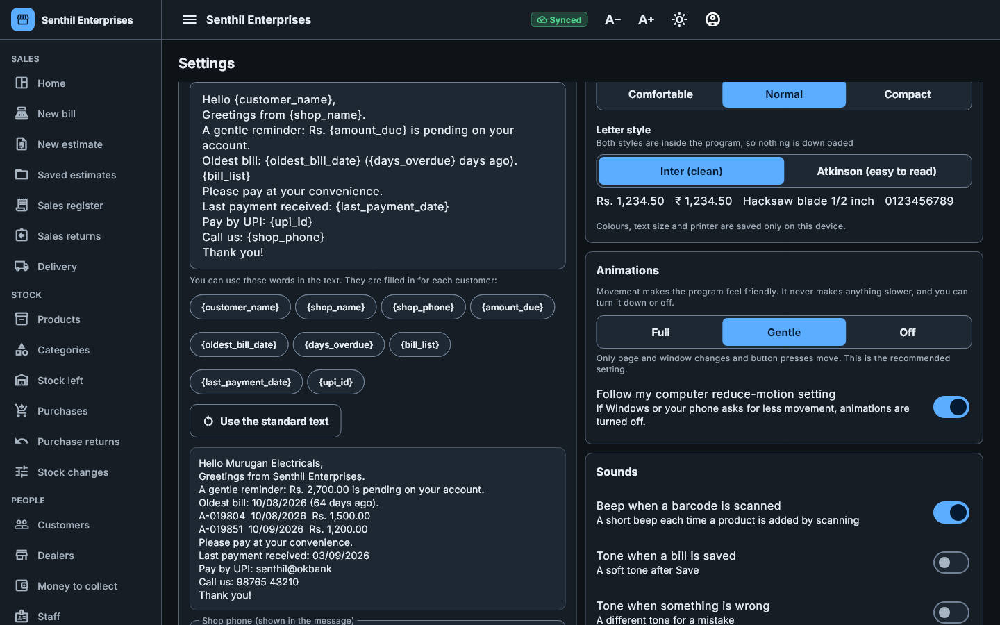 |
| A4 invoice with Received and Balance (light) | 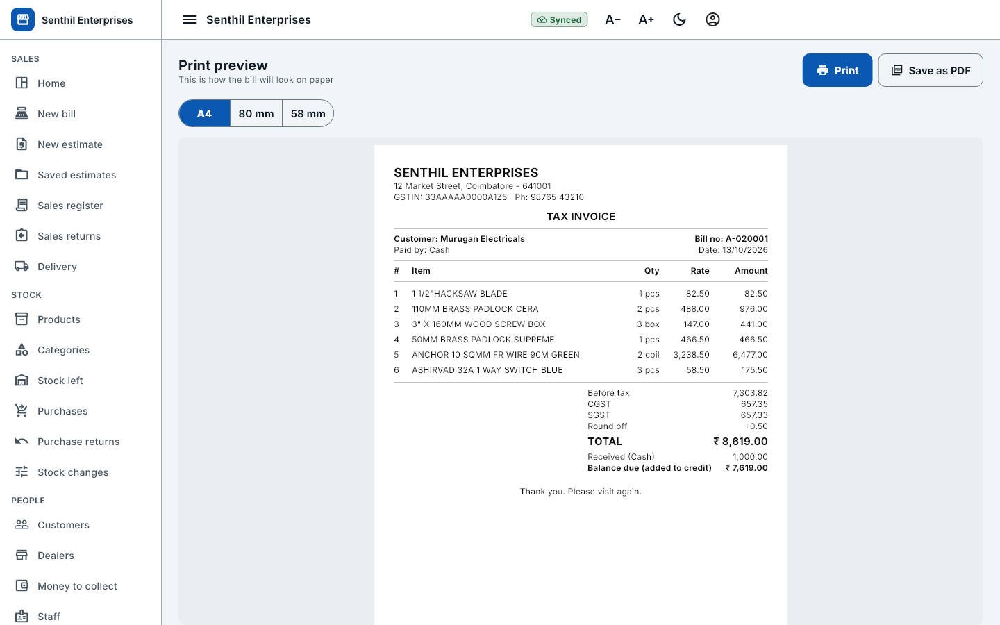 |
| Phone: New bill | 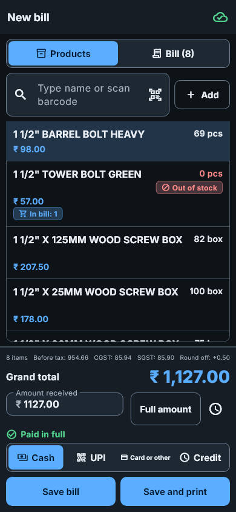 |
| Phone: Money to collect | 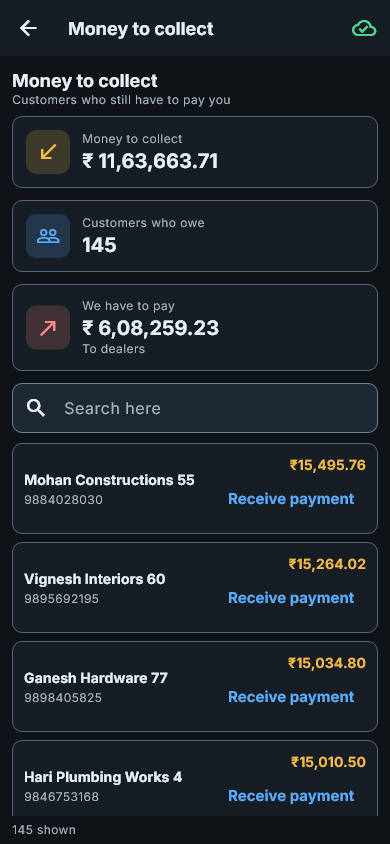 |
| New bill at 200% text | 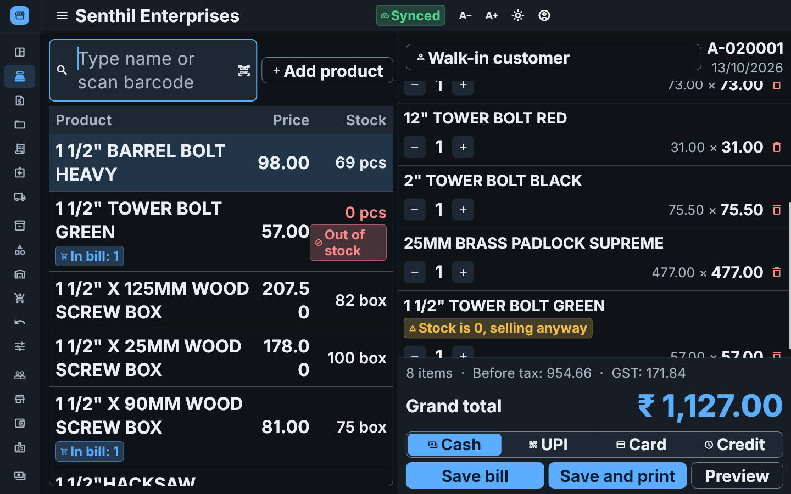 |

## Name and logo
The app is **ASK ERP 2.0**, with the same logo as ERP 1.0 (`assets/branding/ask-logo.png`; every icon is built from it by `dart run tool/make_icons.dart`).

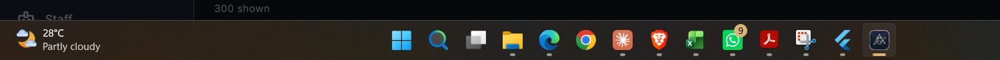
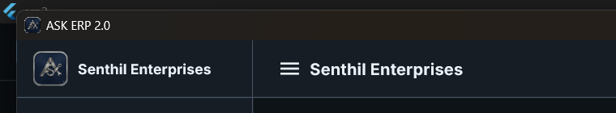
